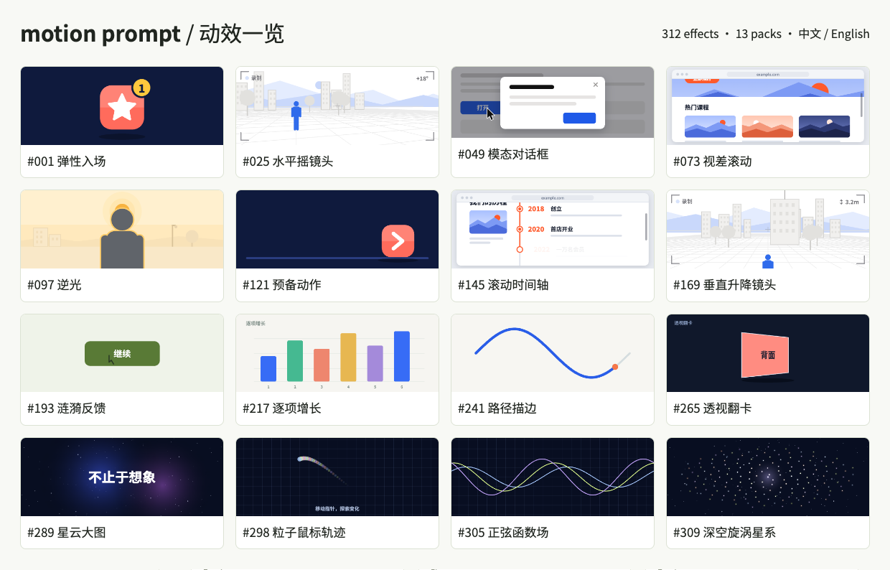

# Motion Prompt Studio

English · [简体中文](README.md)

A bilingual motion workspace with **324 effects in 14 packs**, live previews, and composable prompts.

[Vercel site](https://motion.yipoo.com/) · [Premium & account](https://motion.yipoo.com/account.html) · [Free GitHub Pages library](https://yipoo.github.io/motion-prompt/)

The free library stays open. Vercel hosts both the frontend and billing API; Supabase provides authentication, Postgres and private files. Stripe is sandbox-only, and 198 motions are Free and 126 require Pro, according to each catalog entry’s tier for hosted prompt/specification/export access. The separate premium design pack is still being prepared. See the [integration plan](docs/stripe-integration-plan.md), [verification record](docs/stripe-verification.md) and [backend setup](billing/README.md).

## Effect gallery

16 real rendered keyframes covering the original 13 packs. [Explore the live library](https://yipoo.github.io/motion-prompt/).

[](https://yipoo.github.io/motion-prompt/)

Install **this** skill:

```sh
npx skills add yipoo/motion-prompt --skill motion-prompt
```

Gallery: https://yipoo.github.io/motion-prompt/

```sh
npm install
npm run build
npm run dev
```

Open the printed local URL, normally `http://127.0.0.1:4173/`. This is a static site: no backend, AI API key or external font service is required.

The gallery, motion specifications and generated prompts support English and Simplified Chinese. Text **inside** animated canvases follows the language too, including GO!, character-by-character animation, UI labels and camera HUDs. Noto Sans SC is bundled under the SIL Open Font License.

Search, filter, save favourites, scrub the timeline, customize animated text, inspect reference code, select several effects, compose complete prompts, export JSON and share selections. Favourites, picks, notes and custom text survive reloads. Responsive desktop/mobile layouts and reduced-motion preferences are supported.

The inherited CLI additionally supports `--lang zh-Hans`:

```sh
node skills/motion-prompt/scripts/motion-prompt.mjs prompt 020 --lang zh-Hans
node skills/motion-prompt/scripts/motion-prompt.mjs pick --local --lang en
```

Prompts copied in the gallery use the current origin. For a GitHub Pages deployment, build the static API with your real site URL:

```sh
SITE_URL=https://your-name.github.io/your-repo/ npm run build
```

Publish the repository as a static directory. Use `npm run build` for this redesign; GitHub Actions packages and deploys the static site.

With the local server running, `npm test` checks all 324 exported implementations in both languages at four timestamps: **2,592 frame comparisons**, plus bundled fonts, translated GO, clipboard, persistence, sharing, custom text, responsive layouts and reduced motion. Tiny anti-aliasing differences are tolerated (at most 2 channel levels and under 0.5% changed channels). Screenshots and the report are saved in `.oil-ui/studio/`.

This verifies reproducibility of the reference implementations and prompt links; it is **not** a benchmark of outputs from external AI models.

Translation sources: `translations/`. UI and shared prompt generator: `studio/`. Bundled font and license: `assets/fonts/`.

See [LICENSE](LICENSE) and [THIRD-PARTY-NOTICES.md](THIRD-PARTY-NOTICES.md) for copyright and licensing, and `assets/fonts/OFL.txt` for the bundled font license.

The new atmosphere pack (289–312) includes large hero banners, sitewide cursor trails, deep space and mathematical backgrounds. Open an effect for a fullscreen pointer preview; cursor effects can also run across the gallery with a non-blocking transparent overlay.

Contact: [dinglei2025@gmail.com](mailto:dinglei2025@gmail.com). Regenerate the actual preview grid with `npm run preview:readme` while the local server is running.

## Interface patterns

The new interface pack (#313–#324) adds 12 original loading, feedback, and reading mechanisms: six Free and six Pro. See [classification, tiers, and verification](docs/interface-patterns.md). Complete Agent components belong in [ADP](https://adp.yipoo.com/).

## Static content and discoverability

`npm run build` generates bilingual landing pages, pack collections and an individual page for every motion under `out/public/`. Start at `/zh/` or `/en/`; the existing interactive workspace lives at `/studio/`. Historical hash and picker URLs remain compatible. Public explanations are readable without JavaScript and preview renderers load on demand.

Immutable IDs and public editorial fields live in `packs/*/meta.json`; `content/identities.json` protects existing identities. Hosted Free/Pro exports retain their access boundaries. Run `npm run check:seo` for document, language, canonical, link, sitemap and public-projection validation. See [the architecture and maintenance notes](docs/seo-architecture.md).
