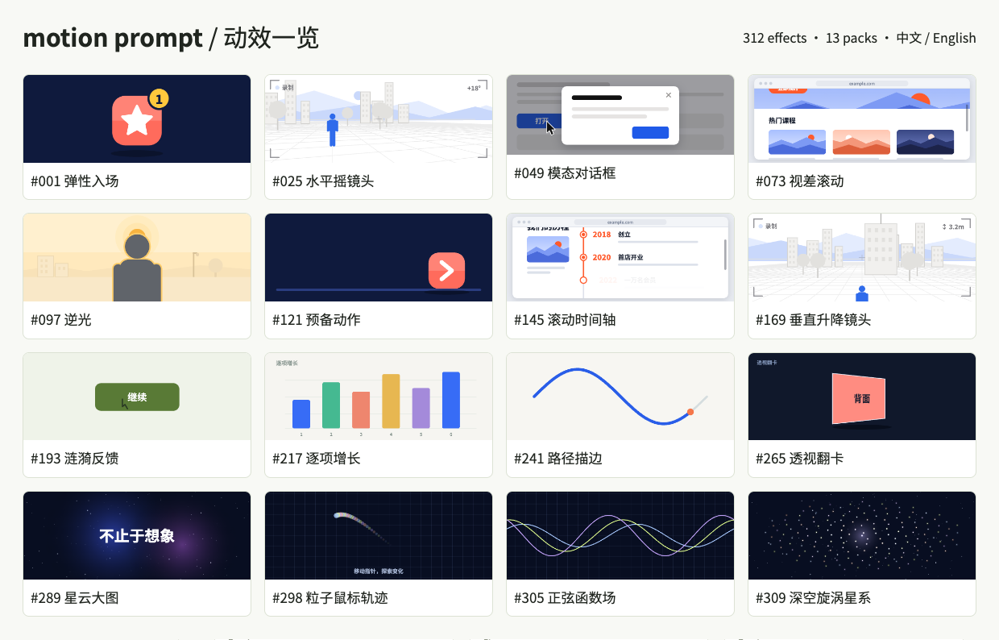

# Motion Prompt Studio

[English](README.en.md) · 简体中文

中英文动效工作台，共 **324 个动效、14 个素材包**，支持浏览、实时预览与 prompt 组合。

[Vercel 主站](https://motion.yipoo.com/) · [精品包与账户](https://motion.yipoo.com/account.html) · [GitHub Pages 免费库](https://yipoo.github.io/motion-prompt/)

免费库保持开放。Vercel 同时承载前端与支付接口，Supabase 提供登录、数据库与私有文件存储。Stripe 目前仅启用沙盒，198 个动效为 Free、126 个为 Pro；按条目的 tier 字段控制站内规格、prompt 与导出权限。独立精品设计包仍在准备中。部署和验证说明见 [支付接入方案](docs/stripe-integration-plan.md)、[验证记录](docs/stripe-verification.md) 与 [后端说明](billing/README.md)。

## 效果速览

以下网格图来自 16 个实际动效的渲染帧，覆盖原有 13 个素材包。[打开完整动效库，查看完整实时效果库](https://yipoo.github.io/motion-prompt/)。

[](https://yipoo.github.io/motion-prompt/)

## 安装你的 AI 技能

```sh
npx skills add yipoo/motion-prompt --skill motion-prompt
```

安装后可对 AI 说“打开 motion-prompt 动效库”。技能包来自本仓库，演示在 [GitHub Pages](https://yipoo.github.io/motion-prompt/)。

## 运行

```sh
npm install
npm run build
npm run dev
```

打开终端显示的本机地址，默认 `http://127.0.0.1:4173/`。纯静态网站，实际使用不需要后端、模型 API Key 或外部字体服务；测试使用本机 Chrome。

## 功能

- 中文、英文界面、名称、描述、规格和 prompt。1,364 项规格完整翻译，保留原始参数。
- 动画内文字同样随语言切换。`GO!` → `出发！`，`Hello!` → `你好！`；逐字动画在拆分字符前翻译。中文穿越缩放保留圆环孔洞锚点。
- 自带 Noto Sans SC 可变字体（SIL OFL 1.1），涵盖基本中日韩汉字区，无需预装或远程字体。
- 中英文/编号/关键词搜索，分类，收藏，排序，暂停与播放；尊重系统减少动态设置。
- 详情实时预览、时间轴拖动、自定义演示文字、精确规格、完整 prompt、参考代码。
- 多选组合 prompt，需求备注、剪贴板复制、JSON 导出、选择分享链接。
- 收藏、选用、需求和自定义文字保存在浏览器，刷新后恢复。
- 桌面与手机响应式布局，键盘 `/` 搜索、左右方向键切换详情、Escape 关闭。

单项 prompt 包含效果说明、精确时序与缓动、参考实现、共享辅助代码、语言、字体和验收条件。组合 prompt 保留每个条目的完整规格。

## 新增动效

| 编号 | 素材包 | 覆盖范围 |
| --- | --- | --- |
| 193–216 | micro | 涟漪、磁吸、拖拽吸附、重排、输入反馈、撤销等微交互 |
| 217–240 | data | 图表、计数、仪表、节点与数据流 |
| 241–264 | vector | 路径、遮罩、波形、矢量与文字排版 |
| 265–288 | spatial | 透视、空间、弹簧、重力与粒子 |
| 289–312 | atmosphere | 横幅大图、全站鼠标跟随、粒子轨迹、深空与函数 |
| 313–324 | interface | 加载节奏、弹性边界、长按确认、液态标签、文字与阅读进度；6 Free / 6 Pro |

## AI 工具与命令行

```sh
node skills/motion-prompt/scripts/motion-prompt.mjs search 弹性 --lang zh-Hans --refresh
node skills/motion-prompt/scripts/motion-prompt.mjs get 020 --lang zh-Hans
node skills/motion-prompt/scripts/motion-prompt.mjs prompt 020 --lang zh-Hans
node skills/motion-prompt/scripts/motion-prompt.mjs pick --local --lang zh-Hans
```

CLI 完整支持英文与简体中文。通过 `pick --local` 打开时，组合窗口会显示“交给 AI”，保留原有本机令牌校验。参考实现依赖所标注的共享 kit、`studio/locale.js` 与项目字体。

网站复制的链接自动使用当前访问地址。发布到自己的 GitHub Pages 时，在构建时设置 `SITE_URL`，让静态 API 和 CLI prompt 也使用正确地址：

```sh
SITE_URL=https://your-name.github.io/your-repo/ npm run build
```

将本仓库作为静态目录发布即可；`.nojekyll` 已保留。不应把本机分享链接当作外网链接；正式演示使用 https://yipoo.github.io/motion-prompt/ 。

## 沉浸式效果与鼠标体验

在“横幅与沉浸效果”中点击任一条目，可打开“全屏体验”，移动鼠标或拖动手指探索大图。鼠标类效果还提供“全站体验”：透明画布覆盖页面并跟随指针，仍可点击分类、搜索和复制，点击“退出鼠标效果”即可关闭。

所有新增条目均提供中英规格、参考代码和可复制 prompt。全站效果层使用 `pointer-events: none`，不抢占页面操作。

## 联系作者

[Ding Lei · dinglei2025@gmail.com](mailto:dinglei2025@gmail.com)

## 效果验证

```sh
npm run dev
# 另一个终端
npm test
# 重新生成 README 效果网格图
npm run preview:readme
```

检查完整翻译、内置字体、324 个动效在中英两种语言下的参考代码复现，每种语言每个动效取四个时间点，共 **2,592 帧**。对比从 prompt 中的 URL 读回的独立导出实现与画廊渲染，允许极小的浏览器抗锯齿误差（最多 2 色阶且少于 0.5% 通道）。另外验证中文 GO、剪贴板、组合、分享恢复、收藏持久化、自定义文字、移动端、放大等效视口及减少动态设置。

报告和截图在 `.oil-ui/studio/`。这是参考实现的可复现性验证，**不是多个外部 AI 模型的生成质量评测**，也不保证所有模型仅凭自然语言都能一次生成完全一致的结果。

## 维护

- `studio/`：界面、语言包、共享 prompt 生成器与生成的双语素材包。
- `translations/`：192 项中文 summary、use 和 spec 的翻译源。
- `packs/`：上游原始素材及元数据，保留原时序。
- `tools/build-studio.mjs`：合并翻译，生成双语参考代码、API prompt 和页面。
- `assets/fonts/`：自托管 Noto Sans SC WOFF2 与字体许可证。
- `api/v1/`：静态目录、规格、prompt 与共享 kit。

请使用 `npm run build` 构建此版本；部署工作流会打包静态文件并发布到 GitHub Pages。

授权与版权说明见 [LICENSE](LICENSE) 和 [THIRD-PARTY-NOTICES.md](THIRD-PARTY-NOTICES.md)；字体授权见 `assets/fonts/OFL.txt`。

## 界面模式收录

新增 12 项为独立实现，参考分类、Free / Pro 清单及验证范围见 [界面模式收录说明](docs/interface-patterns.md)。完整 Agent 交互组件由 [ADP](https://adp.yipoo.com/) 提供。

## 静态内容站与搜索入口

`npm run build` 会同时生成 `out/public/` 下的双语内容站：`/zh/`、`/en/`、素材包列表和每项动效的独立详情页。原交互工作台位于 `/studio/`，历史 hash、素材包及 picker 链接继续兼容。详情页正文无需 JavaScript 即可阅读，预览按需加载。

条目身份和公开内容在 `packs/*/meta.json`，`id` 固定不随排序改变；身份基线位于 `content/identities.json`。Free / Pro 的导出边界保持不变。构建自动验证 canonical、双语、链接、Sitemap 与公开字段白名单；可单独运行 `npm run check:seo`。路由、镜像域名和内容维护方法见 [SEO 架构说明](docs/seo-architecture.md)。
